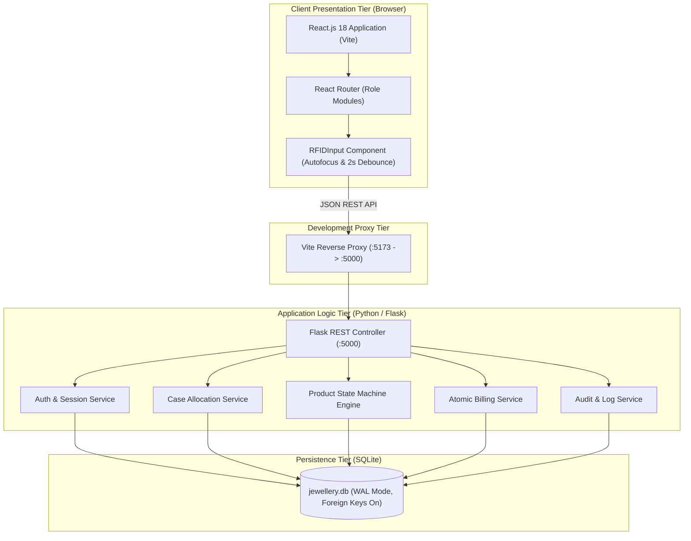
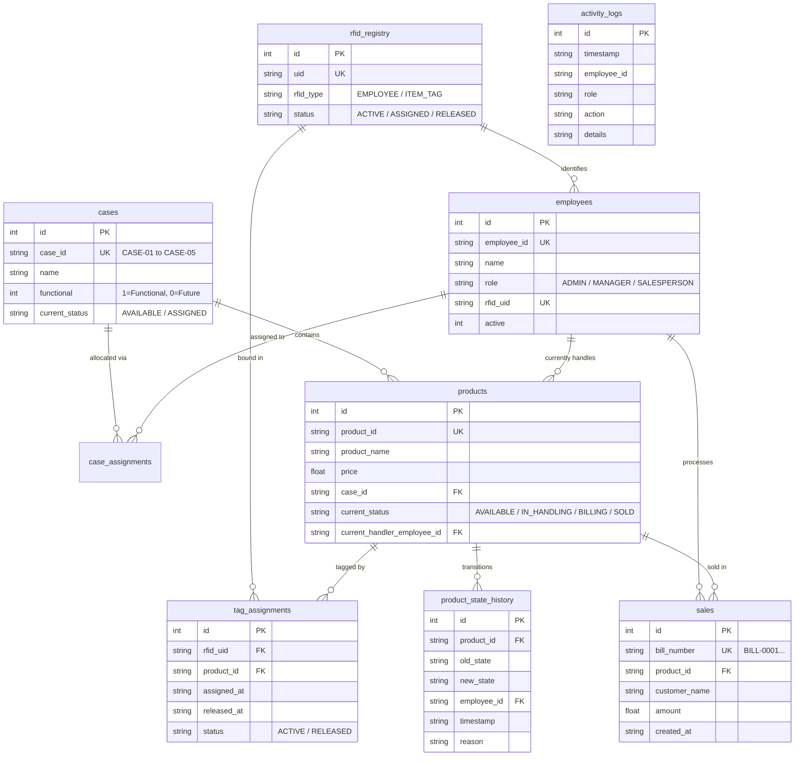
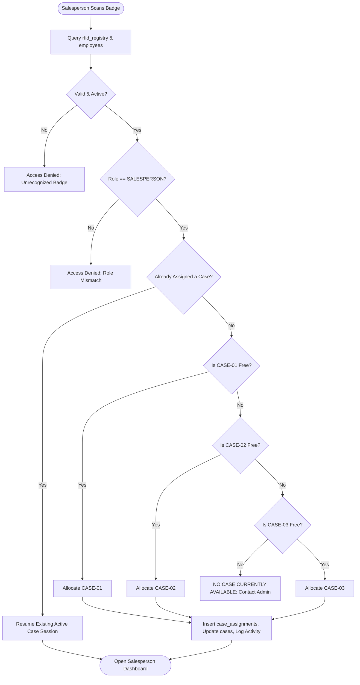
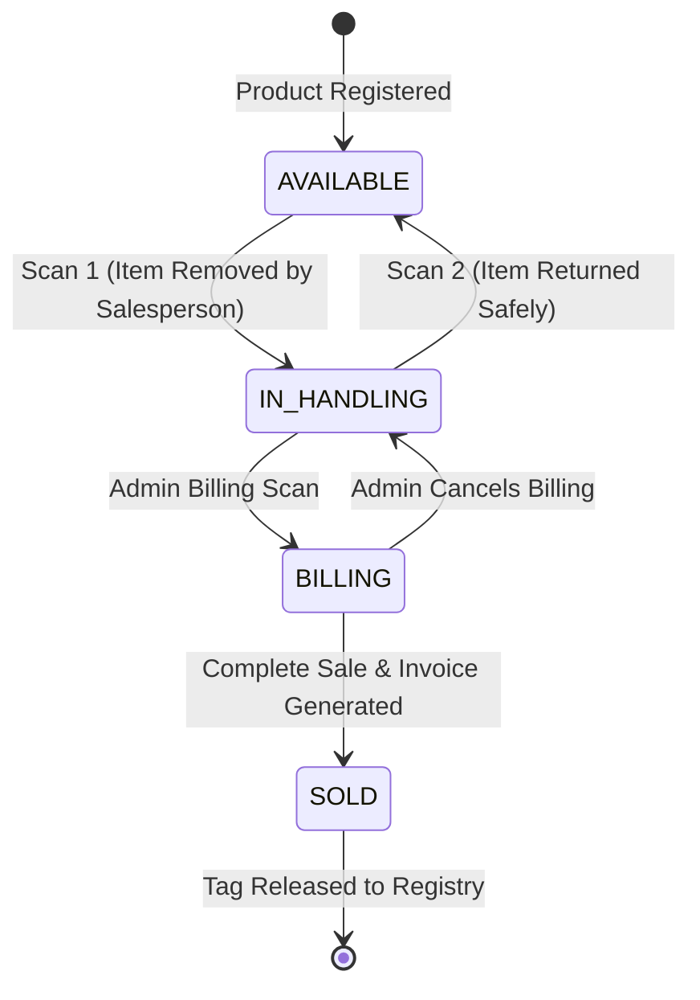
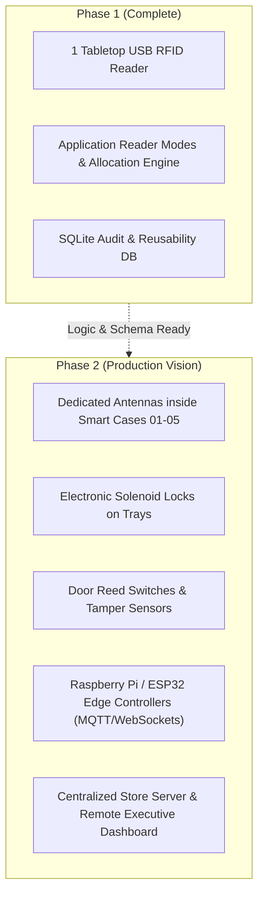

# Executive Technical Project Report: Lumina RFID
## Phase-1 Smart Jewellery Store Handling & Monitoring Prototype

**Project Title:** Lumina RFID — Smart Jewellery Store Handling & Monitoring System  
**Document Version:** 1.0 (Official Technical Review & Prototype Specification)  
**Date:** October 7, 2026  
**Target Audience:** Executive Leadership, Project Sponsors, Store Operations Heads, Technical Review Board  

---

## Table of Contents
1. [Executive Summary](#1-executive-summary)
2. [Problem Statement & Business Motivation](#2-problem-statement--business-motivation)
3. [Prototype Scope & Single-Reader Architectural Innovation](#3-prototype-scope--single-reader-architectural-innovation)
4. [System Architecture](#4-system-architecture)
   - 4.1 High-Level Architecture Diagram
   - 4.2 Frontend Architecture (React.js & Vite)
   - 4.3 Backend Architecture (Python & Flask)
   - 4.4 Data Layer Architecture (SQLite, WAL Mode, Acid Guarantees)
5. [Core Business Entities & Database Schema](#5-core-business-entities--database-schema)
   - 5.1 Database Entity Relationship Overview
   - 5.2 Mandatory Separation: Permanent Products vs Reusable RFID Tags
6. [Operational User Roles & Access Boundaries](#6-operational-user-roles--access-boundaries)
7. [Comprehensive Workflow Diagrams](#7-comprehensive-workflow-diagrams)
   - 7.1 End-to-End System Lifecycle Flow
   - 7.2 Salesperson Authentication & Automatic Priority Case Allocation
   - 7.3 Single-Reader Item Handling State Machine
   - 7.4 Integrated Store Billing & Atomic Sale Execution
   - 7.5 Physical RFID Tag Reassignment & Lifecycle Chain
8. [Failure Prevention & Preventative Validations](#8-failure-prevention--preventative-validations)
9. [Physical Hardware Integration & Reader Debounce Model](#9-physical-hardware-integration--reader-debounce-model)
10. [Auditability, Traceability & Management Oversight](#10-auditability-traceability--management-oversight)
11. [Scalability & Roadmap (Phase-2 Smart Case Vision)](#11-scalability--roadmap-phase-2-smart-case-vision)
12. [Conclusion & Recommendations](#12-conclusion--recommendations)

---

## 1. Executive Summary

In high-value retail environments like jewellery stores, inventory shrink, handling ambiguities, lack of custodial accountability, and inefficient manual counts present substantial operational and financial risks. 

**Lumina RFID (Phase 1)** provides an enterprise-grade proof of concept demonstrating how **Radio Frequency Identification (RFID)** can automate custodian tracking, inventory handling, point-of-sale transitions, and physical tag reuse on a standard Windows PC using **one commercial USB RFID reader**.

The Phase-1 system successfully proves:
1. **Strict Custodial Accountability**: Jewellery cannot leave a case without an authenticated salesperson linked to the active handling session.
2. **Context-Aware RFID Reader Modes**: The software dynamically contextualizes raw card scans based on user session and operational view.
3. **Rigid Product State Machine**: Jewellery strictly enforces lifecycle transitions: `AVAILABLE` ⇄ `IN_HANDLING` ⇄ `BILLING` → `SOLD`.
4. **Physical RFID Tag Reusability**: Physical RFID tags are released upon sale completion and can be rebound to new products while preserving historical assignments without data loss.
5. **Permanent Immutable Audit Trail**: All case allocations, item scans, billing events, and tag reassignments are timestamped on the server.

---

## 2. Problem Statement & Business Motivation

Traditional jewellery store operations face distinct challenges:

| Operational Challenge | Traditional Approach | Lumina RFID Solution |
| :--- | :--- | :--- |
| **Handling Custody** | Salespersons manually pull items; no real-time record of who holds which tray item. | Salesperson badge allocates case; scanning an item marks them as `current_handler` instantly. |
| **Shrink & Item Misplacement** | Discrepancies discovered hours later during end-of-day manual ledger counts. | Salespersons are blocked from clocking out if items remain `IN_HANDLING` or `BILLING`. |
| **Tag Reusability & Cost** | RFID tags are often discarded or their old metadata is overwritten in crude databases. | Strict relational separation: product records are permanent; tags transition to `RELEASED` and can be rebound with full audit history. |
| **Capital Expenditure** | Enterprise RFID deployments often demand multi-antenna readers and edge controllers per cabinet before software validation. | Phase 1 validates the complete operational logic on a single USB tabletop reader before hardware investment. |

---

## 3. Prototype Scope & Single-Reader Architectural Innovation

### The Single-Reader Constraint
Phase 1 was architected around a single tabletop USB RFID reader that emulates a USB HID (Human Interface Device / Keyboard). It outputs an RFID Card Unique Identifier (UID) followed by a carriage return.

```text
[ Physical RFID Tag / Badge ]
              │
              ▼
   [ USB RFID Tabletop Reader ] (HID Emulation)
              │
              ▼ (Keystroke UID)
 [ Application Reader Mode Engine ]
              │
    ┌─────────┴─────────────────────────────────────────┐
    ▼                                                   ▼
Employee Card Scan                               Jewellery Tag Scan
Context: SALESPERSON_LOGIN / MANAGER_LOGIN       Context: ITEM_HANDLING / BILLING / REGISTRATION
```

### Context-Aware Reader Modes
To prevent erroneous cross-operations with one reader, the UI/UX maintains an **Application-Level RFID Reader Mode Engine**:
- `EMPLOYEE_REGISTRATION`: Scans are validated as staff badges.
- `PRODUCT_REGISTRATION`: Scans register jewellery tags.
- `SALESPERSON_LOGIN`: Authenticates staff and allocates cases.
- `MANAGER_LOGIN`: Unlocks store oversight.
- `ITEM_HANDLING`: Determines item removal/return based on active salesperson case.
- `BILLING`: Initiates invoice generation.

---

## 4. System Architecture

### 4.1 High-Level Architecture Diagram



### 4.2 Frontend Architecture (React.js & Vite)
- **Role Isolation**:
  - `/admin/*`: Staff onboarding, product registration, case overview, billing counter, RFID registry.
  - `/salesperson/*`: Fast badge login, automatic case allocation, single-reader item removal/return desk.
  - `/manager/*`: Store oversight, case allocations, product movement logs, sales records, RFID reuse chains.
- **RFID Input Component (`RFIDInput.jsx`)**:
  - Automatically captures hardware keystrokes from USB HID readers.
  - Features software debounce (2 seconds) to avoid duplicate physical reads.
  - Supports manual text entry for environments testing without physical tags.

### 4.3 Backend Architecture (Python & Flask)
- Blueprint architecture (`auth_routes.py`, `admin_routes.py`, `salesperson_routes.py`, `billing_routes.py`, `manager_routes.py`).
- Stateless REST endpoints returning JSON data payloads.
- Native Python 3.14 datetime management (`datetime.now().strftime('%Y-%m-%d %H:%M:%S')`).

### 4.4 Data Layer Architecture (SQLite, WAL Mode, ACID Guarantees)
- Embedded SQLite with `PRAGMA foreign_keys = ON;` and `PRAGMA journal_mode = WAL;`.
- Operations modifying multiple tables (e.g., Complete Sale) run in atomic transactions:
  - Product updated to `SOLD`.
  - Sale row created.
  - Active `tag_assignments` closed with `released_at`.
  - RFID registry updated to `RELEASED`.
  - Audit trail and state transition history inserted.

---

## 5. Core Business Entities & Database Schema



---

## 6. Operational User Roles & Access Boundaries

```text
                      ┌───────────────────────────┐
                      │    LUMINA RFID PORTAL     │
                      └─────────────┬─────────────┘
                                    │
         ┌──────────────────────────┼──────────────────────────┐
         ▼                          ▼                          ▼
  ┌──────────────┐          ┌──────────────┐           ┌──────────────┐
  │ ADMIN MODULE │          │ SALESPERSON  │           │   MANAGER    │
  └──────┬───────┘          └──────┬───────┘           └──────┬───────┘
         │                         │                          │
  • Employee Reg.           • Badge Login              • Store Metrics
  • Product Reg.            • Auto Case Alloc.         • Case Status
  • Case Config             • Item Removal             • State History
  • Billing Counter         • Item Return              • Tag Chains
  • RFID Registry           • Activity Log             • Audit Logs
```

---

## 7. Comprehensive Workflow Diagrams

### 7.1 End-to-End System Lifecycle Flow

```mermaid
sequenceDiagram
    autonumber
    actor Admin
    actor Salesperson
    actor Customer
    participant App as Lumina RFID App
    participant DB as SQLite DB

    Admin->>App: Register Staff (EMP001) & Product (JWL001 in CASE-01 with TAG001)
    App->>DB: Persist in employees, products, rfid_registry, tag_assignments

    Salesperson->>App: Scan Badge EMP_RFID_001
    App->>DB: Check availability; allocate CASE-01
    App-->>Salesperson: Open Salesperson Dashboard (CASE-01 Active)

    Salesperson->>App: Scan Item TAG001
    App->>DB: State Transition: AVAILABLE -> IN_HANDLING (Handler: EMP001)

    Customer->>Salesperson: Inspects item and decides to buy
    Salesperson->>Admin: Escorts customer with item to Billing

    Admin->>App: Scan TAG001 at Billing Counter
    App->>DB: State Transition: IN_HANDLING -> BILLING

    Admin->>App: Enter Customer details & Complete Sale
    App->>DB: Atomically mark SOLD, generate BILL-0001, release TAG001

    Admin->>App: Register new product JWL002 using TAG001
    App->>Admin: Detects RELEASED tag -> Prompts for Reassignment
    Admin->>App: Confirms Reassignment
    App->>DB: Bind TAG001 to JWL002 (Old history for JWL001 preserved!)
```

### 7.2 Salesperson Authentication & Automatic Priority Case Allocation



### 7.3 Single-Reader Item Handling State Machine



### 7.4 Physical RFID Tag Reassignment & Lifecycle Chain

```text
========================================================================================
                          PHYSICAL RFID TAG LIFECYCLE CHAIN
========================================================================================

TIMELINE 1:
  Physical Tag UID : TAG001
  Assigned Product : JWL001 (22K Gold Ring)
  Status           : ACTIVE
  Case             : CASE-01

TIMELINE 2 (Sale Completed):
  Product State    : JWL001 -> SOLD (Timestamp: 2026-10-07 12:03:06)
  Sale Invoice     : BILL-0001
  Physical Tag UID : TAG001 -> RELEASED (Available in Registry)

TIMELINE 3 (Tag Reassignment):
  Admin registers new product : JWL007 (Diamond Bracelet) in CASE-02
  Scans same physical tag     : TAG001
  System Action               : Flags tag as RELEASED from JWL001
  Confirmation                : Admin clicks "Confirm Reassign"
  New Association             : TAG001 -> JWL007 (Status: ACTIVE)

DATABASE AUDIT PRESERVATION:
  tag_assignments Row 1: TAG001 | JWL001 | Assigned: 10:00 | Released: 12:03 | RELEASED
  tag_assignments Row 2: TAG001 | JWL007 | Assigned: 12:05 | Released: NULL  | ACTIVE
  (Row 1 is NEVER updated or overwritten. Complete chain is preserved permanently!)
========================================================================================
```

---

## 8. Failure Prevention & Preventative Validations

| Failure Scenario | Threat / Risk | Enforced System Protection |
| :--- | :--- | :--- |
| **Duplicate Employee RFID** | Card cloned or assigned to multiple staff members. | Blocked with HTTP 409 and error referencing existing employee. |
| **Cross-Entity RFID Collision** | Staff badge used as jewellery tag, or vice versa. | Central `rfid_registry` enforces separation. |
| **Wrong Case Item Scan** | Salesperson accidentally handles jewellery from another case. | System validates `product.case_id == salesperson.case_id`. Blocked if mismatch. |
| **Unauthorized Handling Transfer** | Staff member scans an item already in another salesperson's hands. | Blocked with alert: `ITEM ALREADY IN HANDLING by [Handler Name]`. |
| **Premature Logout with Active Items** | Staff clocks out while holding jewellery. | Logout API rejects request with HTTP 409 if active items remain. |
| **Invalid State Transitions** | Item moved from `AVAILABLE` directly to `SOLD` or `BILLING`. | State machine validates old state before allowing transition. |
| **Double-Billing / Double-Click** | Network lag causes double complete sale click. | Backend verifies sale record existence before committing. |
| **Inactive Case Allocation** | System assigns unequipped future cases (`CASE-04`, `CASE-05`). | Allocation engine strictly restricted to functional cases (`01`–`03`). |

---

## 9. Physical Hardware Integration & Reader Debounce Model

### USB HID Hardware Behavior
Standard USB RFID readers operate without proprietary drivers:
1. Card enters antenna RF field (13.56MHz or 125KHz).
2. Reader reads UID and sends it as keyboard strokes followed by `Enter`.
3. If held in field, some readers send repeat keystrokes every 200–500ms.

### Software Debounce Layer
To prevent accidental state toggling, `RFIDInput.jsx` enforces a 2-second debounce:
```javascript
const now = Date.now();
if (trimmed === lastScan.uid && now - lastScan.time < 2000) {
  setFeedback({ type: 'warning', text: 'Duplicate scan ignored (debounce).' });
  return;
}
```

---

## 10. Auditability, Traceability & Management Oversight

The **Store Manager Dashboard** gives executive visibility into:
1. **Case Status View**: Real-time occupation of all 5 store cases.
2. **Case Allocation History**: Preserved logs of every shift allocation and case release.
3. **Product State History**: Every state change logged with actor, case, timestamp, and reason.
4. **Sales Records**: Sequential bills with customer, item, handler, and price.
5. **RFID Reuse History**: Complete audit chain of physical tags across products.
6. **Full System Audit Trail**: Central audit log capturing logins, removals, returns, cancellations, and sales.

---

## 11. Scalability & Roadmap (Phase-2 Smart Case Vision)

Phase 1 provides the business and logic foundation for Phase-2 physical hardware deployment:



---

## 12. Conclusion & Recommendations

The **Lumina RFID Phase-1 Prototype** successfully proves the core business logic, user flow, custodial security model, and physical tag reuse workflow. 

It satisfies all prototype criteria:
- **Zero unnecessary enterprise complexity**: Self-contained React + Flask + SQLite stack.
- **Single-Reader Viability**: Contextual RFID modes enable complete lifecycle testing with one tabletop device.
- **Reliable Audit Trail**: Never overwrites historical records.

**Recommendation:** Proceed with executive live demonstration using the manual testing guide, followed by planning Phase-2 hardware integration for smart-case enclosures.
